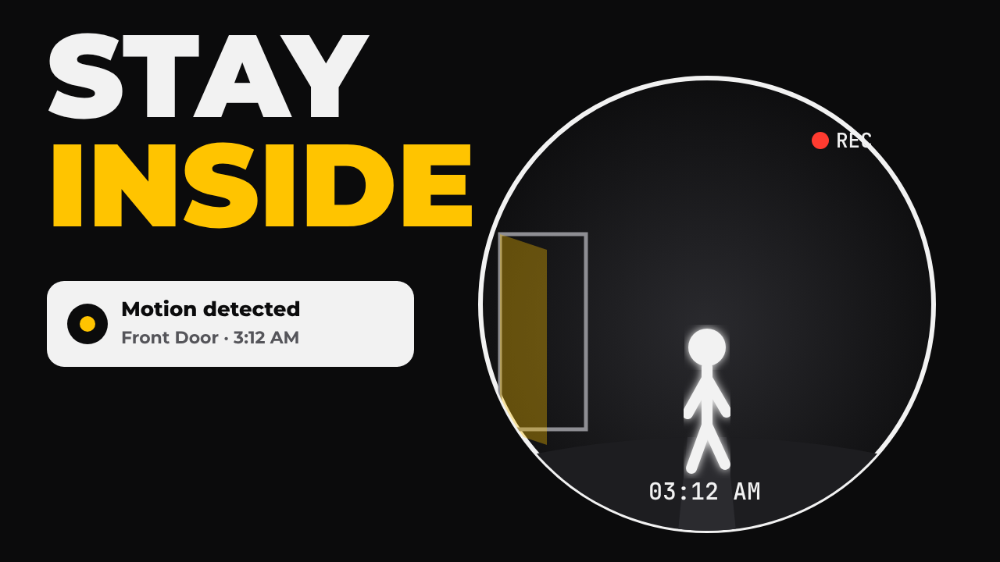
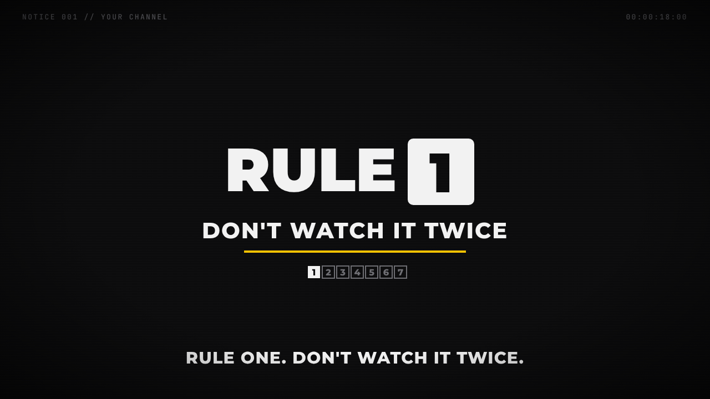
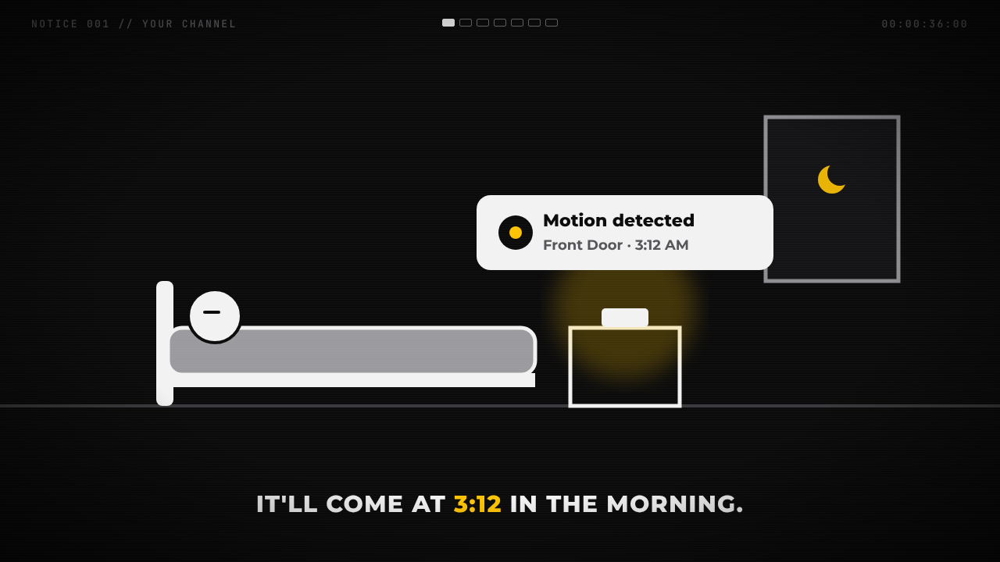
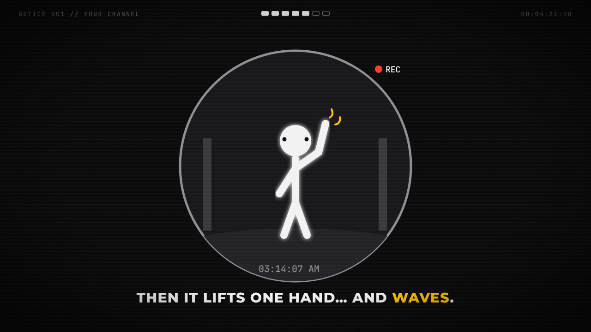
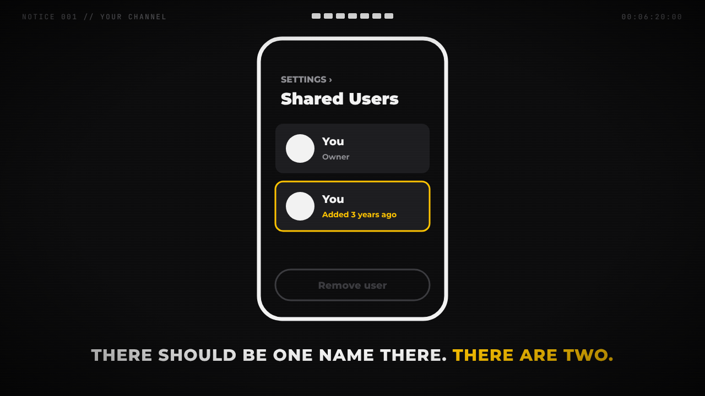
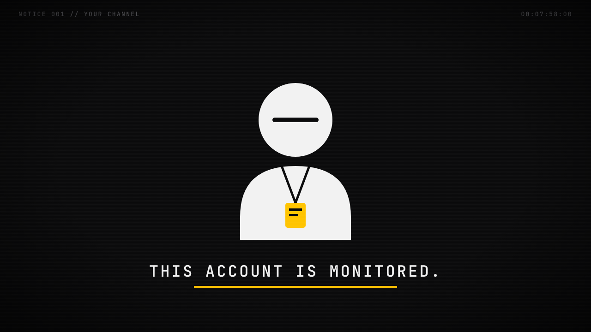

# Visual Style Guide: "Rules" Channel Image Layout

This guide covers the look you're borrowing from the genre (minimal glowing stick figures on black) and the identity that's **yours** (caution-yellow accent, NOTICE files, "The Residents' Office").

Rendered mockups are in [`storyboard/`](storyboard/). Open `storyboard.html` in a browser or view the PNGs.

| | |
|---|---|
|  |  |
|  |  |
|  |  |

---

## 1. What his frames actually look like (from the videos)

- **Canvas:** 16:9, near-black background, lots of empty negative space.
- **Characters:** Faceless white stick figures with a round head and thick, rounded limbs, slightly glowing. A face appears only when it's the "wrong" thing (eyes, a dash for a closed eye).
- **Props:** Flat white or gray line art (bed, door, nightstand, houses, car). Only 1–3 objects per frame.
- **Light:** One warm glow source per scene (a light under the door, a phone screen, a lit window). That glow tells the eye where the danger is.
- **Accent:** One red element per frame (the clock digits, an ✕ over an object, the command word).
- **HUD:** Tiny gray monospace text top-left (`FILE 053 // BRADIKININ`), a rule-progress indicator top-center, a timecode top-right.
- **Caption:** Every VO line appears as ALL CAPS, bold sans-serif, white, bottom-center, one line at a time.
- **Texture:** A slight VHS/CRT layer: vignette, faint scanlines, chromatic-aberration glitch on scene cuts, occasional rewind (◀◀) icons.
- **Motion:** Slow. Pans, slow zooms, figures walking at half speed, a door handle turning. Nothing fast except glitch cuts.

## 2. Your palette (distinct from his red)

| Token | Hex | Use |
|---|---|---|
| Background | `#0B0B0C` | Every frame |
| Ink | `#F2F2F2` | Figures, captions, line art |
| Gray | `#8E8E93` | Secondary props, walls, door frames |
| Dim | `#3A3A3E` | Floor lines, disabled UI |
| **Accent (caution yellow)** | `#FFC400` | Command word, ✕ marks, the "danger glow", highlighted caption words |
| REC red | `#FF3B30` | Only for camera REC dots, nowhere else |

Rule: **one yellow thing per frame.** If everything is yellow, nothing is scary.

## 3. Type

| Element | Font | Size @1080p | Notes |
|---|---|---|---|
| Captions | Montserrat ExtraBold (800) | 44–48 px | ALL CAPS, letter-spacing 0.04em, bottom margin about 80 px. Highlight one keyword in yellow. |
| Rule card ("RULE 3") | Montserrat Black (900) | 160 px | The number sits in a white box with black digit |
| Rule subtitle | Montserrat ExtraBold | 60 px | Yellow underline bar beneath |
| HUD | JetBrains Mono | 18 px | Gray `#6D6D72`, letter-spacing 0.18em |
| Thumbnail words | Montserrat Black | 220–260 px | Max 2 words. Word 1 is white, word 2 is yellow. |

All of these are free Google Fonts.

## 4. Frame template (1920×1080)

```
┌────────────────────────────────────────────────────────────┐
│ NOTICE 001 // YOUR CHANNEL      ■■■□□□□        00:03:12:00 │  ← HUD (gray, mono)
│                                                            │
│                                                            │
│                 [ 1–3 white line-art objects ]             │  ← subject in center 60%
│                 [ one figure, one glow source ]            │
│                                                            │
│ ────────────────────────────────────────────────────────── │  ← floor line (dim)
│                                                            │
│           CAPTION LINE IN ALL CAPS, ONE <YELLOW> WORD      │  ← bottom-center
└────────────────────────────────────────────────────────────┘
```

**Scene types to reuse every episode (build these once, swap props):**
1. **Bedroom side view:** bed (left), nightstand + device (center), window or door (right).
2. **Hallway/door:** a single door, centered, with a glow under it.
3. **Street:** a row of house outlines; one lit window.
4. **Phone UI close-up:** a rounded rectangle with a notification banner or settings list.
5. **Camera POV:** a fisheye circle with a REC dot and timestamp (new for this channel).
6. **Map pin anecdote:** a dark map, a yellow pin, a city name in caps.
7. **Rule card:** "RULE N" + subtitle + 7 pips.
8. **Split screen:** two identical scenes side by side with one difference.

## 5. Thumbnail formula

- **Background:** solid black (default) or solid caution yellow (for one-in-four videos, to break the grid).
- **Left 50%:** 2-word command stacked (white / yellow).
- **Right 50%:** One iconic object in white line art, with a single "wrong" detail (101%, 25:00, an extra user, a figure in the lens).
- **No faces, no photos, no arrows.** It must read at 160×90 px. Test by shrinking it in your phone gallery.
- **Thumbnail word ≠ title command.** Title: "…STAY INSIDE". Thumbnail: "STAY INSIDE" is fine for a first upload. For A/B tests, try a *different* angle ("IT'S NOT YOU", "DON'T WAVE"). He does the same: the title "DON'T HURRY HIM" pairs with the thumbnail "YOU'RE EARLY".

## 6. Motion and editing recipe (per caption line)

| Element | Setting |
|---|---|
| Caption | Hard cut in, no animation, held for the full VO line plus 6 frames |
| Scene change | Every 2–4 captions. Hard cut with a 4-frame RGB-split glitch. |
| Camera | Constant slow push-in (100% to 106% over the scene) |
| Figures | Walk cycles at about 60% normal speed. Heads turn slowly. |
| Danger beats | Fade the glow in over 1 s; hold silence |
| Rule cards | 2.5 s hold, a pip fills, plus a low "thud" SFX |
| Rule 7 card | Glitches twice and holds 4 s |
| Overlay | Vignette, 3% scanlines, film grain 5%. On scene cuts, 1-frame ◀◀ rewind icon (sparingly). |

**Tools:** After Effects or **CapCut desktop** (free) are enough. Build each scene as a reusable template in Figma, Canva or Illustrator. Export PNG layers and animate position/scale. A whole 8-minute video is about 40–60 unique frames.

## 7. AI image prompt (if you generate base art)

> minimalist flat vector illustration, pure black background, simple white glowing stick figure with round head and thick rounded limbs, faceless, thin white line-art furniture, single warm yellow light source, lots of negative space, side view, 16:9, no text, clean editorial horror style, slight VHS glow

Then clean it up and redraw the line art in vector so every episode looks consistent. Consistency is the brand.

## 8. Your channel identity checklist

- [ ] Your own channel name (not a play on his)
- [ ] Mascot: The **Residents' Office clerk**, a faceless head with a horizontal visor line and a yellow lanyard ID badge (see `06-sign-off.png`)
- [ ] HUD text: `NOTICE ### // YOUR CHANNEL`
- [ ] Sign-off line: **"This account is monitored."**
- [ ] Banner: a row of white house outlines, one with a lit yellow window labeled "YOURS". Tagline: *"Notices for things your house won't tell you."*
- [ ] Same notification "ding" SFX in every video (an audio logo)
